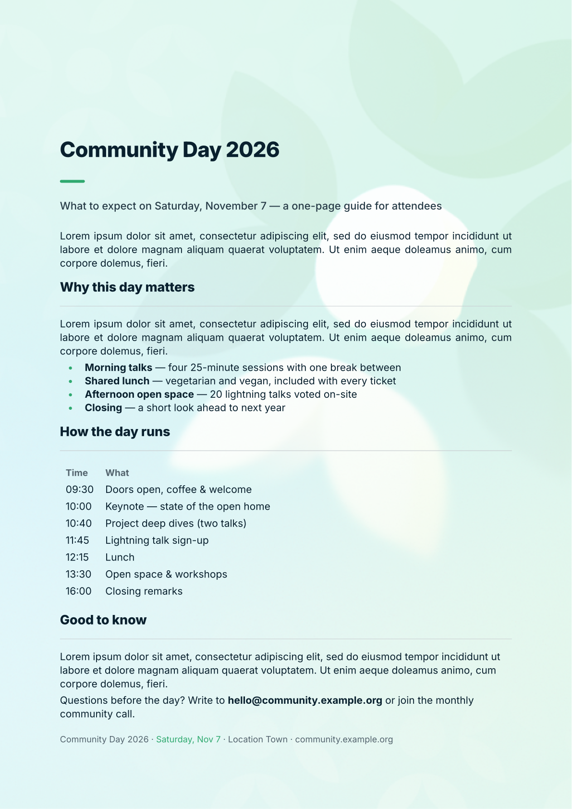

# Documents

The dir `assets` contains assets used for documents and presentations, `.typ` files in this dir are sample Typst documents for A4 handouts/posters and presentations.

The Typst compiler is available to download at https://typst.app/open-source/. Alternatively, you can use the web-editor at https://typst.app/app. You should be able to upload the whole `assets` directory to the editor and then copy and paste the example you want to start with.

 

